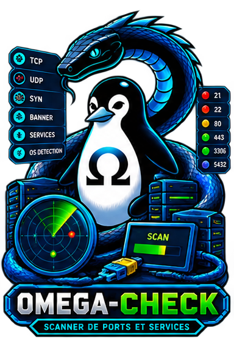

<!-- Copyright (c) 2026 kraynux - kraynux@proton.me - Lisensi MIT (lihat berkas LICENSE) -->
<div align="center">
  
</div>

#  OMEGA-CHECK

**Pemindai port, layanan, dan peran jaringan (satu target)**

> Dibuat oleh [kraynux](https://github.com/kraynux) untuk [Omega-Server](https://kraynux.snake-mackarel.ts.net)   

Halaman resmi: [OMEGA-CHECK](https://kraynux.snake-mackarel.ts.net/omega-check/) &nbsp; Pratinjau: [Screenshots](https://kraynux.snake-mackarel.ts.net/omega-check/screenshots/)  

[](../../../LICENSE)
[](https://www.python.org/)
[](https://www.linux.org/)
[](https://github.com/Textualize/rich)

🌐 Antarmuka dan laporan ekspor tersedia dalam **17 bahasa** — lihat [Bahasa antarmuka](#bahasa-antarmuka).  
**Bahasa:**  
 [Français](../../../README.md) ·  [English](../en/README.md) ·  [Español](../es/README.md) ·  [Português (Brasil)](../pt-BR/README.md) ·  [Italiano](../it/README.md) ·  [Deutsch](../de/README.md) ·  [Nederlands](../nl/README.md) ·  [Polski](../pl/README.md) ·  [Русский](../ru/README.md) ·  [中文](../zh-CN/README.md) ·  [Tiếng Việt](../vi/README.md) ·  [ไทย](../th/README.md) ·  [Bahasa Indonesia](README.md) ·  [日本語](../ja/README.md) ·  [한국어](../ko/README.md) ·  [हिन्दी](../hi/README.md) ·  [العربية](../ar/README.md)

---

**Omega-check** adalah alat TUI + CLI yang memindai port dari satu target jaringan, mengenali layanan yang berjalan di setiap port terbuka (protokol, perangkat lunak, versi, autentikasi, WAF, TLS), dan menyimpulkan perannya yang paling mungkin, tanpa pernah melakukan serangan aktif. Alat dari rangkaian `omega-`, disusun dengan Clean Architecture — lihat `docs/ARCHITECTURE.md` untuk detail teknis lengkap.

## 1. Visi dan cakupan

Omega-check adalah pemindai port yang ditujukan untuk administrasi sistem: memeriksa dengan cepat apa yang mendengarkan di sebuah mesin (milik sendiri, di LAN, atau target eksternal yang diizinkan), dengan apa, dan seberapa yakin setiap informasi dapat dipegang.

### Yang dilakukan Omega-check

- Memindai daftar port (profil sistem, profil pribadi, atau isian bebas) pada satu target.
- Mengenali layanan di setiap port terbuka: protokol (HTTP/HTTPS/SSH/TLS/VNC/umum), perangkat lunak dan versi bila terlihat, kebutuhan autentikasi.
- Menyimpulkan peran yang paling mungkin (server web, akses shell, akses grafis, basis data) dari protokol yang benar-benar dinegosiasikan, tidak pernah dari sekadar dugaan nomor port.
- Mendeteksi tanda tangan WAF yang dikenal (Cloudflare, Sucuri, Akamai, Imperva Incapsula) bila dideklarasikan di header.
- Menampilkan hasil di TUI (Textual) atau CLI untuk skrip, serta melalui tiga ekspor: JSON, teks, HTML (5 tema).
- Memberi setiap informasi yang terkumpul tingkat keyakinan yang jelas — lihat [§7](#7-kebijakan-keyakinan).
- Menyimpan riwayat pemindaian permanen yang dapat diulang dan dibandingkan dari waktu ke waktu.
- Memungkinkan menyematkan target dan membuat profil port pribadi yang dapat dipakai ulang dari satu pemindaian ke pemindaian berikutnya.

### Yang tidak dilakukan Omega-check

- Pemindaian kerentanan aktif: tanpa SQLi, XSS, atau RCE.
- Pemindaian CVE.
- Pengenalan sistem operasi (model data menyediakan kolomnya, belum ada heuristik yang mengisinya).
- Teknik pemindaian tingkat rendah ala nmap (SYN scan, paket mentah) — hanya koneksi TCP tingkat aplikasi.
- Alat brute force atau fuzzing.
- Pemindaian banyak target secara paralel.
- Dasbor web.

## 2. Instalasi

### Prasyarat

- Python 3.10+
- Koneksi Internet, untuk dependensi

### Instalasi

```bash
[ -d omega-check ] && echo "ℹ️ Sudah diekstrak di sini, langkah dilewati." || tar -xzf omega-check.tar.gz
cd omega-check/
chmod +x install.sh
./install.sh
```

`install.sh`:

1. Membuat lingkungan virtual `.venv` jika belum ada.
2. Memasang dependensi (`pip install -e .`; `pyproject.toml` tetap menjadi satu-satunya sumber kebenaran).
3. Menjadikan `omega-check.sh` dan `install.sh` dapat dieksekusi.
4. Menambahkan alias `check` ke `~/.bashrc` dan `~/.zshrc` (tanpa duplikat jika sudah ada).

### Dependensi

Dideklarasikan di `pyproject.toml` (tidak ada lagi `requirements.txt`):
- `omega-lib`: pustaka bersama rangkaian (`ConfidenceLevel`, tema, deteksi terminal)
- `textual`: antarmuka TUI, tema, penyesuaian otomatis dengan terminal
- `httpx`: probe HTTP/HTTPS
- `cryptography`: pembacaan sertifikat TLS yang dinegosiasikan
- `jinja2`: templat untuk ekspor HTML
- Dependensi pengembangan (`pip install -e ".[dev]"`): `pytest`, `pytest-asyncio`, `pytest-cov`, `pytest-httpserver`, `trustme`, `ruff`, `mypy`, `import-linter`

## 3. Penggunaan

### Mode interaktif (TUI)

Disarankan untuk pemakaian sehari-hari — dijalankan tanpa argumen:

```bash
./omega-check.sh
```
jika Anda sudah membuat alias, cukup ketik `check` di terminal:
```bash
check
```

Alur: layar pembuka (tertutup dengan satu tombol atau klik) → menu utama (Pindai / Target / Profil / Riwayat / Pengaturan / Bantuan) → isian target (dengan pemilih target yang disematkan) dan pilihan profil (peringatan untuk `complet`, kolom kedua untuk profil pribadi atau isian port bebas pada `CUSTOM`) → pemindaian (indikator tak tentu dan log operasi jaringan secara langsung) → detail pemindaian (port/layanan/peran, ekspor) → riwayat/perbandingan/pengulangan dan pengaturan dari menu utama. Penyesuaian dengan terminal (warna, ukuran, penyederhanaan struktur) berlangsung otomatis.

#### Pintasan keyboard

| Tombol | Aksi |
|---|---|
| `↑` / `↓` | Berpindah antarelemen layar |
| `Tab` / `Shift+Tab` | Berpindah antarkolom formulir |
| `Esc` | Kembali ke layar sebelumnya (konfirmasi keluar di layar awal) |
| `t` | Tema berikutnya (langsung diterapkan, tanpa konfirmasi) |
| `r` | Menyegarkan deteksi terminal |
| `a` | Menampilkan bantuan |
| `q` | Keluar (dengan konfirmasi) |

### Bahasa antarmuka

Antarmuka tersedia dalam 17 bahasa: Prancis, Inggris, Spanyol, Portugis (Brasil), Italia, Jerman, Belanda, Polandia, Rusia, Tionghoa Sederhana, Vietnam, Thai, Indonesia, Jepang, Korea, Hindi, dan Arab. Pilihan dibuat di Pengaturan (“Langue / Language”) dan berlaku setelah antarmuka dimulai ulang; variabel `OMEGA_CHECK_LANG` (misalnya `OMEGA_CHECK_LANG=id ./omega-check.sh`) memaksakan bahasa untuk satu sesi. Jika dijalankan dari omega-suite, omega-check memakai bahasa rangkaian. Di konsol teks Linux (TTY), bahasa beraksara non-Latin ditampilkan dalam bahasa Inggris selama sesi itu. Baris perintah tetap berbahasa Prancis.

### Mode skrip (CLI)

Setiap subperintah mengaktifkan mode CLI:

```bash
# Memindai target dengan profil port
./omega-check.sh scan 192.168.1.10 --profile minimal

# Riwayat (dapat difilter per target)
./omega-check.sh history --target 192.168.1.10 --limit 20

# Detail pemindaian (teks, JSON, atau HTML) — 5 tema ekspor untuk dipilih
./omega-check.sh show <scan_id> --format html --theme omega-base --output laporan.html

# Membandingkan dua pemindaian (perubahan status port)
./omega-check.sh compare <scan_id_a> <scan_id_b>

# Profil port pribadi
./omega-check.sh profile list
./omega-check.sh profile create lab --ports 22,80,443 --description "Profil saya"
./omega-check.sh profile edit lab --ports 22,80,443,8080
./omega-check.sh profile pin lab
./omega-check.sh profile unpin lab
./omega-check.sh profile delete lab
```

### Format target yang diterima

```text
192.168.1.10                IPv4
example.org                 Nama host
http://example.org          URL HTTP  (skema dihapus sebelum resolusi)
https://example.org:8443    URL HTTPS dengan port  (skema dan port dihapus)
```

Skema dan port, bila ada, dihapus sebelum resolusi DNS (`domain/targets/validation.py::normalize_target_input`) — menempelkan URL lengkap tetap berfungsi, hanya host yang disimpan.

## 4. Profil pemindaian

| Profil | Deskripsi | Disematkan |
|---|---|---|
| `minimal` | Pemindaian sangat cepat: SSH + HTTP + HTTPS (22, 80, 443) | ya |
| `classic` | Layanan Internet/LAN umum (37 port) | ya |
| `web` | Layanan web dan alternatifnya | tidak |
| `db` | Basis data dan layanan data | tidak |
| `remote` | Akses jarak jauh — shell, desktop, RustDesk | tidak |
| `mail` | Layanan surel | tidak |
| `dns` | Layanan DNS | tidak |
| `iot` | Perangkat IoT, kamera, router, rumah pintar | tidak |
| `dev` | Lingkungan pengembangan/laboratorium | tidak |
| `docker` | Docker, Swarm, dan layanan umum dalam kontainer | tidak |
| `complet` | **Dibuat seketika**: gabungan terurut tanpa duplikat dari semua profil di atas | tidak |
| `CUSTOM` | Profil pribadi yang dibuat di layar **Profil**, dan/atau isian bebas (`80` / `22,443,8080` / `1000-2000`) — keduanya dijumlahkan, tanpa duplikat | tidak |

Detail lengkap, aturan validasi, dan pengelolaan profil pribadi: `docs/PROFILES.md`.

## 5. Arsitektur

Omega-check disusun dengan **Clean Architecture** (domain / application / infrastructure / interfaces / ports / core / app / plugins / shared), selaras dengan templat rangkaian `omega-` (lihat `omega-scan`/`omega-stress`) dan diverifikasi oleh `import-linter` pada setiap perubahan. Detail lengkap ada di **`docs/ARCHITECTURE.md`**.

Gambaran singkat:

```text
src/omega_check/
├── domain/          Logika bisnis murni (pemindaian, target, layanan, profil, laporan...)
├── application/     Kasus penggunaan (commands/queries)
├── ports/           Kontrak yang diharapkan aplikasi (probe, repositori, pengekspor...)
├── infrastructure/  Implementasi konkret (socket/httpx/cryptography, SQLite; Textual TIDAK ada di sini)
├── interfaces/      tui/ (Textual) dan cli/ (untuk skrip), dengan kesetaraan fungsi yang ketat
├── app/             Perakitan (DependencyContainer, bootstrap, siklus hidup)
├── core/, shared/   Kosakata lintas bagian, utilitas nonbisnis
└── plugins/         Struktur sudah disiapkan, kosong (belum ada arah perluasan yang dipastikan)
```

Aturan desain:
- `domain/services/policies.py`: menggolongkan petunjuk yang sudah terkumpul, tidak pernah mengakses jaringan.
- `infrastructure/network/`: mengakses jaringan (soket, `httpx`, `cryptography`), tidak pernah menilai.
- `interfaces/`: menampilkan, tidak berisi logika bisnis apa pun.
- `infrastructure/exporters/`: membaca hasil pemindaian, tidak menghitung ulang apa pun.

## 6. Pengenalan layanan dan peran

### Protokol yang dideteksi

| Protokol | Probe | Detail yang dikumpulkan |
|---|---|---|
| HTTP / HTTPS | `httpx` | Banner `Server`, header autentikasi |
| TLS | `cryptography` (sertifikat yang dinegosiasikan, termasuk `CERT_NONE`) | Versi, cipher, subjek/penerbit sertifikat |
| SSH | Banner mentah | Perangkat lunak dan versi (mis. `OpenSSH 10.4`) |
| VNC (RFB) | Kode keamanan yang diumumkan server | Jenis autentikasi yang didukung |
| Umum | Banner mentah pada port terbuka yang tidak dikenali | Ekstraksi hati-hati, tanpa heuristik agresif |

### Peran yang disimpulkan

Disimpulkan dari protokol yang **benar-benar dinegosiasikan**, tidak pernah dari dugaan nomor port:

| Peran | Syarat | Keyakinan |
|---|---|---|
| `server web` | Protokol HTTP/HTTPS terkonfirmasi | `INFERRED` |
| `akses shell` | Protokol SSH terkonfirmasi | `CORROBORATED` |
| `akses grafis` | Protokol VNC terkonfirmasi | `CORROBORATED` |
| `basis data` | Port dalam rentang profil sistem `db` | `INFERRED` |

### Tanda tangan WAF yang dikenal

Dideteksi melalui header deklaratif (`server`, `x-sdk`) — kehadirannya **dideklarasikan oleh target**, tidak pernah diverifikasi secara independen: Cloudflare, Sucuri, Akamai, Imperva Incapsula, AWS ELB (dicantumkan sebagai informasi, sebenarnya bukan WAF aplikasi).

## 7. Kebijakan keyakinan

Setiap kolom yang dikumpulkan memiliki salah satu tingkat berikut:

| Tingkat | Arti |
|---|---|
| `VERIFIED` | Fakta protokol yang diamati langsung, yang tidak dapat dipalsukan target (mis. port tertutup yang dikonfirmasi oleh RST TCP, versi TLS yang benar-benar dinegosiasikan). |
| `DECLARED` | Nilai yang diumumkan sendiri oleh target di kolom yang sepenuhnya ia kendalikan (mis. banner `Server`) — masuk akal tetapi dapat dipalsukan sesuka hati. |
| `CORROBORATED` | Nilai `DECLARED` yang dikonfirmasi oleh petunjuk independen (mis. peran SSH, karena protokolnya benar-benar dinegosiasikan). |
| `INFERRED` | Disimpulkan dari pola/heuristik, tanpa deklarasi eksplisit dari target. |
| `UNKNOWN` | Tidak ada petunjuk yang dapat dipakai, atau sengaja disembunyikan target. |

## 8. Perlindungan terhadap nilai palsu

Omega-check tidak memercayai data apa pun yang dideklarasikan sendiri oleh target tanpa menandainya secara eksplisit. Banner `Server` atau header `X-Powered-By` tetap `DECLARED`, tidak pernah `VERIFIED`, seberapa pun masuk akalnya — target sendirilah yang memberikannya dan dapat memalsukannya sesuka hati. Hanya konfirmasi melalui saluran independen (misalnya protokol SSH yang benar-benar dinegosiasikan untuk peran “akses shell”) yang menaikkan sebuah informasi menjadi `CORROBORATED`. Pembedaan ini, yang dibawa oleh `omega-lib` (`ConfidenceLevel`), bersifat struktural: tidak ada ekspor maupun tampilan yang dapat menyembunyikannya.

## 9. Kompatibilitas terminal

TUI (Textual) otomatis mendeteksi kemampuan terminal (emulator, ukuran) dan menyesuaikan lembar gaya strukturalnya (`complete`/`standard`/`reduced`/`mono`), tanpa opsi manual. Mode CLI selalu berupa teks biasa, tidak bergantung pada terminal. Kebijakan ini dipakai bersama oleh seluruh rangkaian `omega-` (`omega-lib`, `terminal/policies.py`).

### Profil menurut emulator yang terdeteksi

| Emulator | Profil awal |
|---|---|
| Ghostty, Alacritty, WezTerm, Kitty | `complete` |
| Konsole, GNOME Terminal, Terminator, Xfce4 Terminal | `standard` |
| xterm, urxvt, SSH modern | `reduced` |
| TTY Linux, SSH lama | `mono` |
| Emulator tidak dikenal | `reduced` (cadangan bawaan) |

### Profil menurut ukuran terminal

| Ukuran minimum (kolom × baris) | Batas atas profil |
|---|---|
| 120 × 32 | `complete` |
| 100 × 28 | `standard` |
| 80 × 24 | `reduced` |
| di bawahnya | `mono` |

Profil akhir adalah **yang lebih ketat dari keduanya** (emulator dan ukuran) — Ghostty layar penuh yang diperkecil menjadi 70 kolom turun ke `mono`, meskipun emulatornya mengizinkan `complete`. Dapat disegarkan langsung dengan tombol `r`.

## 10. Ekspor

Laporan teks dan HTML ditulis dalam bahasa yang dipilih di Pengaturan (“Bahasa ekspor”, bawaannya sama dengan antarmuka); JSON tetap berupa data dan tidak diterjemahkan. Laporan dibuat di `var/exports/` secara bawaan (jalur runtime yang berjangkar pada folder proyek, `$OMEGA_CHECK_VAR_DIR` untuk menggantinya), atau di jalur yang ditentukan (`--output` di CLI, kotak dialog di TUI). Nama berkas jelas dan bercap waktu: `scan-{profil}-{tanggal}.ext`, `scan-custom-{tanggal}.ext` untuk profil pribadi, `scan-{tanggal}.ext` untuk isian bebas tanpa profil.

### JSON, sumber kebenaran

Struktur lengkap pemindaian (`Scan` + `Host`), sepenuhnya dapat diserialisasi ke JSON, termasuk tingkat keyakinan.

### Teks, laporan ringkas yang mudah dibaca

Dapat dibaca di luar terminal, tanpa kode ANSI.

### HTML, laporan web mandiri

5 tema pilihan (`--theme` di CLI, pemilih di TUI; secara bawaan mengikuti tema antarmuka yang aktif bila ada padanannya). Tata letak khusus: wadah, kisi informasi, kotak statistik per status port, lencana berwarna — keluarga visual yang sama dengan `omega-scan`/`omega-stress`.

## 11. Riwayat dan perbandingan

Setiap pemindaian disimpan (SQLite, `var/db/omega-check.db`): riwayat dapat dilihat per target, detail eksekusi sebelumnya, perbandingan dua pemindaian (status port), dan pengulangan pemindaian pada target yang sama tanpa mengetik ulang.

## 12. Pengujian

```bash
source .venv/bin/activate
lint-imports        # memeriksa Dependency Rule
pytest -q           # 191 pengujian
ruff check src tests
mypy -p omega_check
```

Struktur: `tests/unit/` (domain dan aplikasi, tanpa I/O sungguhan), `tests/integration/` (SQLite/berkas sungguhan, server HTTP tiruan `pytest-httpserver`, TLS melalui `trustme`).

## 13. Di luar cakupan

- Pemindaian CVE
- Deteksi aktif SQLi, XSS, RCE
- Pengenalan sistem operasi
- Teknik pemindaian tingkat rendah ala nmap (SYN scan, paket mentah)
- Crawling
- Fuzzing
- Brute force
- Pemindaian banyak target secara bersamaan
- Dasbor web

---

> Omega-check — Memindai, mengenali, menilai, melaporkan.
> Pemindai port dengan keyakinan yang jelas, bukan dugaan yang menyamar sebagai fakta.
